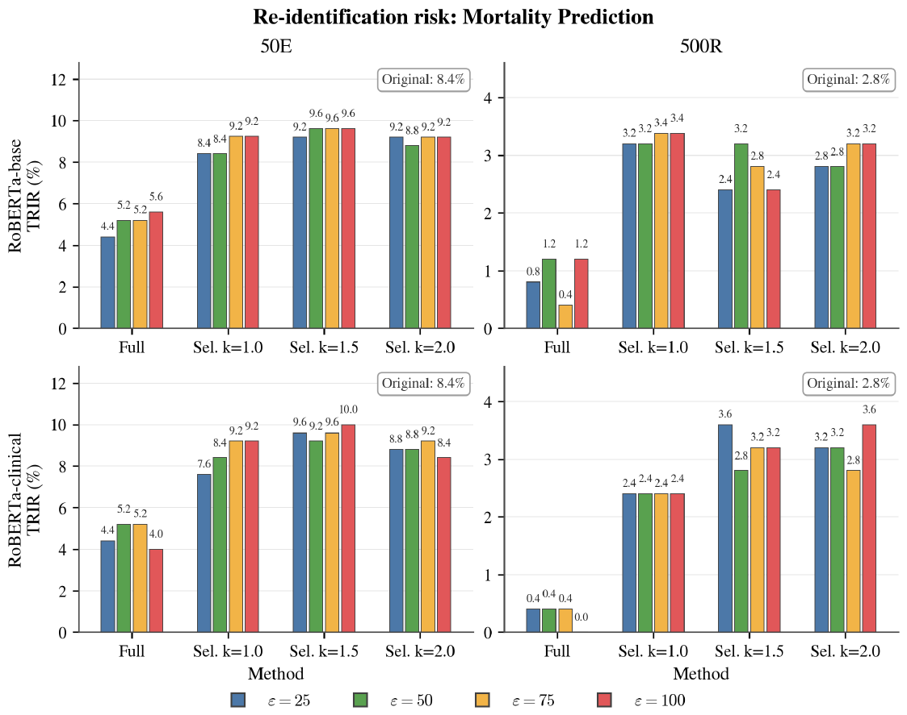

# Rarity-guided selective differential privacy for clinical text rewriting

Code for the master thesis *"Rarity-guided selective differential privacy for clinical text rewriting"* (Maroua Doghri, 2026), written with the DFKI Speech and Language Technology group.

**Idea.** De-identified clinical notes (MIMIC-III) still contain indirect clues (ethnicity, occupation, unusual events) that can re-identify a patient. Rewriting *every* sentence with differential privacy (DP) destroys the text. This project rewrites **only the statistically rare sentences**, found with corpus IDF, using the DP-MLM mechanism (Meisenbacher et al., 2024). It then compares this **Selective DP-MLM** with **Full DP-MLM** (all sentences) on utility and re-identification risk.

```mermaid
flowchart LR
    A[MIMIC-III notes<br/>de-identified] --> B[1 Segment<br/>notes]
    B --> C[2-3 IDF rarity<br/>per sentence]
    C --> D[4 Select rare sentences<br/>r(s) >= mu + k sigma]
    D --> E[5 Clipping bounds<br/>per model]
    E --> F[6 DP-MLM rewrite<br/>eps per token]
    F --> G[7 Rebuild notes]
    G --> H[8 Utility:<br/>Bio_ClinicalBERT ROC-AUC]
    G --> I[Utility:<br/>similarity S, coherence C]
    G --> J[Privacy:<br/>TRI attack, TRIR]
    H & I & J --> K[Trade-off gamma<br/>+ figures]
```

---

## Contents

1. [Results in one minute](#1-results-in-one-minute)
2. [Repository layout](#2-repository-layout)
3. [Installation](#3-installation)
4. [Data](#4-data)
5. [Quick test without MIMIC (toy data)](#5-quick-test-without-mimic-toy-data)
6. [Reproducing the thesis](#6-reproducing-the-thesis)
7. [Script reference](#7-script-reference)
8. [Thesis text vs. code](#8-thesis-text-vs-code)
9. [Known limitations and tips](#9-known-limitations-and-tips)
10. [Citation and credits](#10-citation-and-credits)

---

## 1. Results in one minute

Two tasks (in-hospital mortality **MP**, procedure prediction **PROC**), two rewriting models (RoBERTa-base, RoBERTa-clinical), ε ∈ {25, 50, 75, 100} per token, rarity thresholds k ∈ {1.0, 1.5, 2.0}.

| Finding | Evidence |
|---|---|
| Selective DP-MLM keeps the text usable | semantic similarity S ≈ 0.98, coherence C 0.65–0.93 vs. Full S 0.68–0.90, C 0.05–0.23 |
| Full DP-MLM lowers re-identification more | Full TRIR below the original (e.g. MP 50E 8.4 % → 4.0–5.6 %); Selective stays at the original level |
| Differences between k, ε and models are mostly within noise | 50 targets × 5 seeds = 250 attempts per bar: one correct guess ≈ 0.4 points |

Figures, reported values and how to read them: **[docs/RESULTS.md](docs/RESULTS.md)**.

<p align="center"></p>

---

## 2. Repository layout

```
common/layout.py        settings (models, eps, k, seeds) and ALL file paths, used by every script
pipeline/               steps 1-8: segmentation -> IDF -> selection -> DP-MLM -> notes -> classification
privacy/                TRI re-identification attack, steps 1-5
evaluation/             utility metrics S/C, classification tables, gamma, thesis figures
external/DPMLM_patch/   the thesis' patched DPMLM.py (copied into external/DPMLM by setup)
scripts/                setup_external.sh, prepare_datasets.py, run_all.sh, make_toy_data.py
tests/smoke_test.sh     end-to-end test on synthetic notes (CPU, tiny models)
docs/                   PIPELINE, RESULTS, THESIS_VS_CODE, FUTURE_WORK, CHANGES, HISTORY
figures/thesis/         result figures of the submitted thesis (Chapter 6)
results/thesis_reference/  TRIR and gamma values reported in the thesis (for comparison)
```

All outputs of a task go to `outputs_<task>/`, TRI runs to `privacy_eval/seed_<seed>/`, final tables and figures to `results/`. The full folder tree is listed in [docs/PIPELINE.md](docs/PIPELINE.md#output-layout).

---

## 3. Installation

The thesis ran on the DFKI SLURM cluster with NVIDIA containers and an A6000/V100 GPU. **Two Python environments** are needed, because the FARM classifier only runs on Python 3.8.

| Environment | Used for | Thesis container | Install |
|---|---|---|---|
| main | steps 1–7, S/C, TRI, γ, figures | `nvcr.io/nvidia/pytorch:24.05-py3` (Python 3.10) | `pip install -r requirements.txt` |
| farm | step 8c (classification) only | `nvcr.io/nvidia/pytorch:21.06-py3` (Python 3.8) | `SKLEARN_ALLOW_DEPRECATED_SKLEARN_PACKAGE_INSTALL=True pip install -r requirements-farm.txt` |

Then, from the repository root:

```bash
bash scripts/setup_external.sh           # clones DP-MLM (pinned), van Aken classifier, TRI; downloads Bio_ClinicalBERT
python -m spacy download en_core_web_lg  # needed by the TRI attack (tri.py)
python -c "import wn; wn.download('oewn:2022')"   # WordNet used by DP-MLM
```

`transformers==4.40.2` is pinned on purpose: newer versions refuse the PyTorch build of the 24.05 container.

Models downloaded from Hugging Face during the runs: `FacebookAI/roberta-base`, `pminervini/RoBERTa-base-PM-M3-Voc-hf` (rewriting), `emilyalsentzer/Bio_ClinicalBERT` (classifier), `Qwen/Qwen2.5-7B-Instruct` (TRI backgrounds), `distilbert-base-uncased` (TRI attacker), `gpt2`, `sentence-transformers/all-mpnet-base-v2`, `thenlper/gte-large`, `jinaai/jina-embeddings-v3` (S and C).

---

## 4. Data

MIMIC-III is credentialed data. You need your own PhysioNet access ([physionet.org/content/mimiciii](https://physionet.org/content/mimiciii/)). **Never commit notes or anything derived from them.** `.gitignore` excludes `data/`, `outputs_*/`, `privacy_eval/` and `results/*.csv`.

1. Create the task files with the `tasks/` scripts of [clinical-outcome-prediction](https://github.com/bvanaken/clinical-outcome-prediction) (van Aken et al., 2021): `MP_IN_adm_*.csv` and `PRO_GROUPS_3_DIGITS_adm_*.csv`. Two pandas fixes may be needed in `mimic_utils.py`; see [docs/HISTORY.md](docs/HISTORY.md).
2. Build the 50 % samples used in the thesis (seed 42):
   ```bash
   python scripts/prepare_datasets.py --mp_dir <MP folder> --proc_dir <PROC folder> --out_dir data
   ```
   This writes `data/mp_50pct.csv` (`id, text, hospital_expire_flag`) and `data/proc_50pct.csv` (`id, text, short_codes`).
3. Procedures only: put the label list `ALL_3_DIGIT_PRO_CODES.txt` (codes separated by spaces, produced by the van Aken task scripts) into `outputs_proc/`.

---

## 5. Quick test without MIMIC (toy data)

```bash
pip install -r requirements.txt
SKIP_CLASSIFIER=1 bash scripts/setup_external.sh
python -c "import wn; wn.download('oewn:2022')"
bash tests/smoke_test.sh          # about 10-15 minutes on CPU
```

This generates 60 **synthetic** notes and runs every phase of `scripts/run_all.sh` for both tasks:
- segmentation, IDF and selection;
- clipping bounds and real DP-MLM rewriting, including the chunking and checkpoint/resume checks;
- notes, splits, classification over 3 seeds;
- S and C;
- the real TRI attack over 5 seeds;
- TRIR averages, γ and all figures.

No GPU and no model downloads are needed. The stand-ins, all marked in the script, are:
- tiny random models built locally (`tests/make_tiny_models.py`) instead of RoBERTa, DistilBERT, GPT-2 and Qwen;
- a TF-IDF classifier instead of FARM/Bio_ClinicalBERT, which needs Python 3.8;
- a stub for spaCy's `en_core_web_lg` (unused with the thesis TRI settings).

The numbers it produces are meaningless; the test only shows that every step runs and that the files connect. Run it after any code change.

---

## 6. Reproducing the thesis

All commands are in [`scripts/run_all.sh`](scripts/run_all.sh), split into phases. They can be run one by one, which is recommended because the full runs take days:

```bash
export BASE=$PWD   # folder that contains data/
# heavy steps can be sent to SLURM through a prefix, e.g.:
# export RUN="srun -p RTXA6000 --gpus=1 --mem=64G --time=24:00:00 --container-image=nvcr.io/nvidia/pytorch:24.05-py3 --container-workdir=$PWD"
# export FARM_PY=<python of the FARM environment>

for TASK in mp proc; do
  bash scripts/run_all.sh $TASK prepare    # steps 1-5   (minutes; step 5 needs a GPU)
  bash scripts/run_all.sh $TASK rewrite    # steps 6-7   (days for Full DP-MLM; resumable)
  bash scripts/run_all.sh $TASK classify   # step 8      (3 seeds x 33 trainings)
  bash scripts/run_all.sh $TASK utility    # S and C
  bash scripts/run_all.sh $TASK privacy    # TRI, 5 seeds
done
bash scripts/run_all.sh mp report && bash scripts/run_all.sh proc report   # TRIR averages, gamma, figures
```

**Settings that reproduce the thesis** are the defaults in `common/layout.py`:

| Setting | Value |
|---|---|
| Rarity | IDF = log10((N+1)/(DF+1)) + 1, DF per note; r(s) = mean token IDF; rare if r(s) ≥ μ + kσ, k ∈ {1.0, 1.5, 2.0} |
| Clipping bounds | 1000 sentences from the k = 2.0 rare pool, seed 42, one masked word each; C_min = μ, C_max = μ + 4σ; one file per rewriting model, used for Selective **and** Full |
| DP-MLM | CONCAT mode, `TEMP=True`, `STOP=False`, ε ∈ {25, 50, 75, 100} per token, chunks ≤ 200 sub-word tokens |
| Classification | Bio_ClinicalBERT (FARM), 70/10/20 split with seed 123, training seeds 11/22/33, mean ROC-AUC |
| S and C | 500 notes (seed 42); S = mean cosine of mpnet, gte-large, jina-v3; C = PPL_orig / PPL_priv with GPT-2, first 128 tokens |
| TRI | 50 targets + 450 distractors (50E / 500R), Qwen2.5-7B-Instruct biographies, DistilBERT, 15 epochs, seeds 42/123/456/789/1337 |
| γ | (1 − TRIR_p/TRIR_o) − ⅓[(1 − ROC_p/ROC_o) + (1 − S) + (1 − C)] |

Compare your numbers with `results/thesis_reference/*.csv`. Small differences are expected from GPU nondeterminism and DP sampling.

---

## 7. Script reference

| Step | Script | Input → output (under `outputs_<task>/`) |
|---|---|---|
| 1 | `pipeline/step1_segmentation.py` | `data/<task>_50pct.csv` → `step1_segmented.csv` (`sentences_mimic`) |
| 2 | `pipeline/step2_tokenization.py` | → `step2_tokenized.csv` (`sentences_tokenized`; placeholders, stopwords, digits removed) |
| 3 | `pipeline/step3_idf_calculation.py` | → `step3_idf.csv` (`sentence_idf_mean`), `step3_idf_token_idf.csv` |
| 4 | `pipeline/step4_extract_rare.py --multi-sigma` | → `step4_rare_sigma_{1.0,1.5,2.0}.csv` |
| 4 | `pipeline/step4_extract_all_sentences.py` | → `step4_all_sentences.csv` (Full DP-MLM) |
| 5 | `pipeline/step5_clipping_bounds.py` | → `step5_clipping/<model>/step5_clipping_bounds_sigma_2.0.json` |
| 6 | `pipeline/step6_apply_dpmlm.py` | → `step6_dpmlm/<setup>/<model>/df_rare_dpmlm_sigma_<k\|all>_eps_<ε>.csv` |
| 7 | `pipeline/step7_rebuild_notes.py` | → `step7_notes/<setup>/<model>/priv_notes_*.csv` (`note_private`) |
| 8a | `pipeline/step8a_create_splits.py` | → `step8_splits/<setup>/<model>/eps_<ε>/` and `step8_splits/original/` |
| 8b | `pipeline/step8b_generate_configs.py` | → `step8_configs/.../config.yaml` |
| 8c | `pipeline/step8c_experiments.py --seed S` | → `step8_results/seed_S/.../eval_results.txt` |
| – | `evaluation/collect_classification.py` | → `results/classification_<task>_{seed_S,averaged}.csv` |
| – | `evaluation/compute_utility_metrics.py` | → `results/utility_metrics_<task>.csv` |
| TRI 1–4 | `privacy/tri_step{1..4}_*.py --seed S` | → `privacy_eval/seed_S/…/tri_summary.csv` |
| TRI 5 | `privacy/tri_step5_average.py` | → `results/trir_averaged_results.csv` |
| – | `evaluation/compute_gamma.py` | → `results/gamma_tradeoff_<task>.csv` |
| – | `evaluation/generate_figures.py` | → `results/figures/*.png` (the Chapter 6 figures) |

`<setup>` is `selective_k1.0`, `selective_k1.5`, `selective_k2.0` or `full`; `<model>` is `roberta_base` or `roberta_clinical`. Each step is explained in detail in [docs/PIPELINE.md](docs/PIPELINE.md).

---

## 8. Thesis text vs. code

All numbers in the thesis were produced by this code. In a few places the thesis text describes the method differently or leaves out an implementation detail:

| Topic | Thesis text | Code (= reported results) |
|---|---|---|
| Placeholders `[**…**]` in rarity | counted like other tokens | removed before IDF; rarity reflects the remaining wording |
| Placeholders in rewriting | rewritten with brackets | brackets removed, contents rewritten |
| Long segments | "no chunking" | segments > 200 tokens are rewritten in chunks (512-token model limit) |
| Clipping bounds for Full | whole corpus (Appendix A) | same k = 2.0 bounds as Selective (same Δ everywhere) |
| "Sentence" | sentence | rule-based segment of ≥ 6 words |

Reasons and consequences: **[docs/THESIS_VS_CODE.md](docs/THESIS_VS_CODE.md)**. Fixes made while cleaning up the code (none changes how a successful run computes its results): **[docs/CHANGES.md](docs/CHANGES.md)**.

---

## 9. Known limitations and tips

- **IDF rarity is a lexical stand-in for risk.** It was not validated as a detector of identifying content. A random-selection control with the same rewriting rate is the most important missing experiment. See [docs/FUTURE_WORK.md](docs/FUTURE_WORK.md).
- **The TRI attack is weak and the sample small.** The attacker re-identifies 8.4 % of the *original* notes (chance: 2 %). Report confidence intervals before comparing configurations.
- **ε is per token.** A note's total privacy budget grows with the number of rewritten tokens.
- **Full DP-MLM is slow.** About 567k sentences per task; submit one job per ε. Step 6 resumes from `checkpoint_*.csv` if a job is killed.
- **Step 8c** skips experiments that already have an `eval_results.txt`; use `--force` to re-run. FARM caches data per run in `/tmp/cache_*` to avoid mixing ε values.
- Delete `language_model.bin` / `prediction_head_0.bin` after evaluation to save about 5 GB per run.

---

## 10. Citation and credits

```
@mastersthesis{doghri2026rarity,
  title  = {Rarity-guided selective differential privacy for clinical text rewriting},
  author = {Doghri, Maroua},
  year   = {2026}
}
```

Built on: DP-MLM (Meisenbacher et al., 2024, [sjmeis/DPMLM](https://github.com/sjmeis/DPMLM)), clinical outcome prediction (van Aken et al., 2021, [bvanaken/clinical-outcome-prediction](https://github.com/bvanaken/clinical-outcome-prediction)), and the TRI attack (Manzanares-Salor et al., 2024, [BenetManzanaresSalor/TextRe-Identification](https://github.com/BenetManzanaresSalor/TextRe-Identification)). The evaluation protocol (S, C, TRI, γ) follows DP-IPI (Baroud et al.). Please check the licences of these repositories and of MIMIC-III before reuse.
