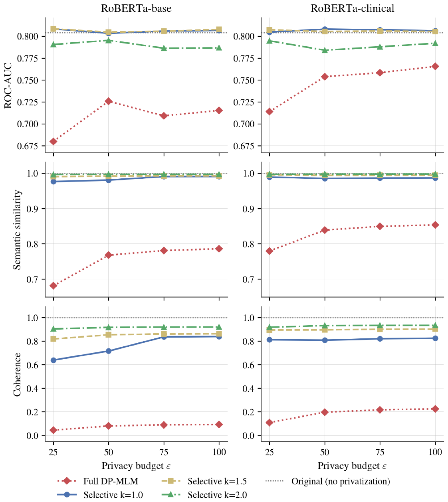
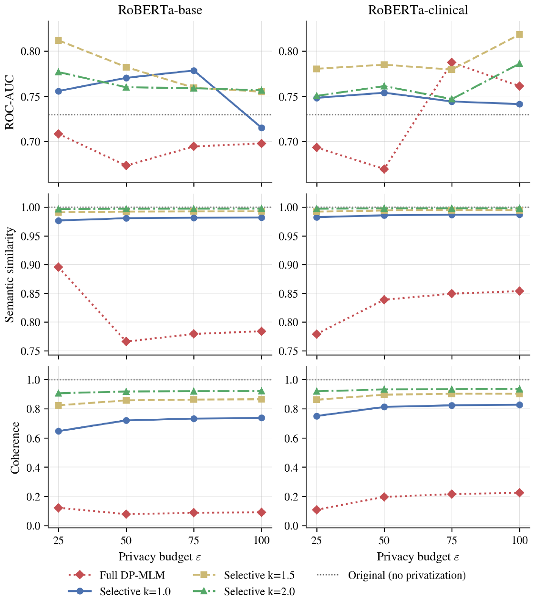
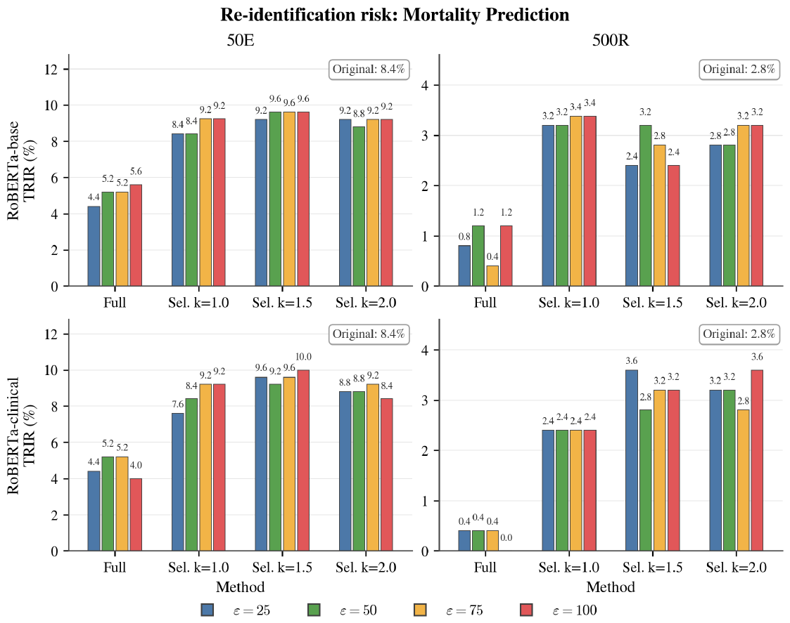
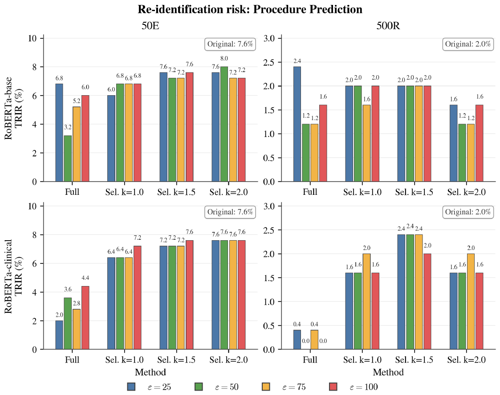
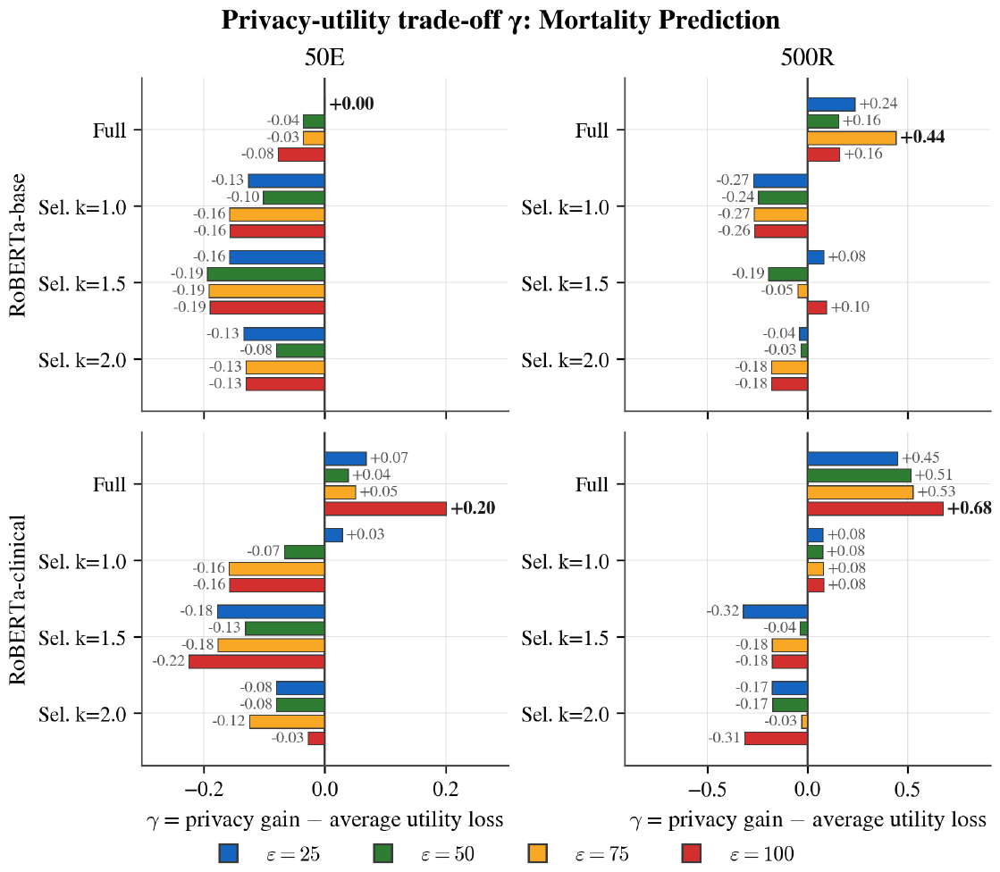
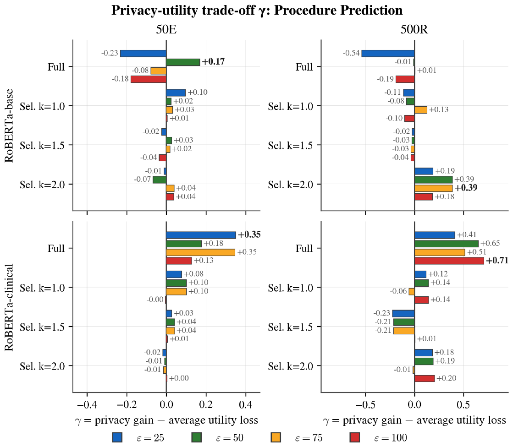

# Results reported in the thesis (Chapter 6)

The figures below are taken from the submitted thesis. The exact TRIR and γ values printed on the bars are in `results/thesis_reference/trir_reported.csv` and `gamma_reported.csv`, transcribed from the figure labels. ROC-AUC, S and C were only reported as plots.

## Utility

 <em>Figure 6.2: mortality prediction</em>

 <em>Figure 6.1: procedure prediction</em>

- **Semantic similarity:** Selective stays at about 0.98 or higher; Full drops to 0.68–0.90.
- **Coherence:** Selective is 0.65–0.93 (lowest for k = 1.0 at ε = 25); Full is 0.05–0.23. Full DP-MLM text is close to unreadable.
- **ROC-AUC, mortality:** Selective ≈ original (≈ 0.80); Full is lower (0.68–0.77).
- **ROC-AUC, procedures:** the curves jump by up to 0.08, and most selective runs are *above* the original (≈ 0.73). Treat this as noise from three seeds and a 711-label task, not as an improvement from rewriting.

## Re-identification risk (TRIR)

| Task | Original 50E | Original 500R | Chance 50E | Chance 500R |
|---|---|---|---|---|
| Mortality | 8.4 % | 2.8 % | 2 % | 0.2 % |
| Procedures | 7.6 % | 2.0 % | 2 % | 0.2 % |

- Full DP-MLM lowers TRIR in most configurations; Selective stays at about the original level.
- **How precise these numbers are:** each bar is the mean over 5 seeds × 50 targets = 250 attempts, so one correct re-identification moves a bar by about 0.4 points.

  | Comparison | Hits | p (Fisher) |
  |---|---|---|
  | MP 50E original 8.4 % [5.6–12.5] vs. Full-clinical ε = 100: 4.0 % [2.2–7.2] | 21 vs. 10 | ≈ 0.06 |
  | MP 500R original 2.8 % vs. Full-clinical ε = 100: 0.0 % | 7 vs. 0 | ≈ 0.015 |
  | MP 50E original 8.4 % vs. Selective k = 1.5 clinical ε = 100: 10.0 % | 21 vs. 25 | ≈ 0.64 |

  Brackets are approximate 95 % Wilson intervals, computed from the bar heights. Differences between k, ε and models are within this noise.
- **The attacker is weak:** it re-identifies only 8.4 % of the unprivatized notes (chance 2 %), which leaves little room to measure privacy gains.

## Trade-off γ

- γ is positive when the relative TRIR reduction exceeds the average relative utility loss.
- In 500R, the TRIR baseline is only 5–7 correct guesses, so a single guess changes γ by about 0.14. That is why Full-clinical gets the highest γ (+0.68, +0.71) although its coherence is about 0.2.
- Read γ as a **descriptive** summary next to the separate metrics, not as a ranking.

## What the results show

- ✔ Selective DP-MLM preserves utility far better than Full DP-MLM.
- ✔ Full DP-MLM lowers re-identification risk, at a large utility cost.
- ✘ The evaluation cannot show that IDF selects the privacy-sensitive sentences: there is no random-selection control, and the attacker is weak.
- ✘ Differences between k, ε and rewriting models are mostly within noise.
